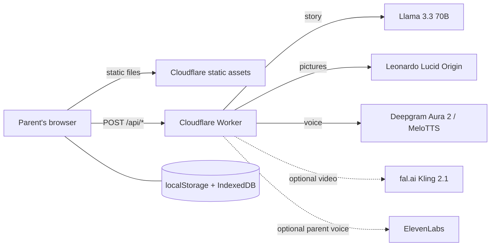

# Architecture

The browser holds everything about the child. The Worker is stateless: it
receives one request, calls one model, and returns the result.

## Request flow for a new story

1. The parent fills in the visit, what scares the child, the favorite thing
   and the language. The browser sends these, without the child's name, to
   `POST /api/story`.
2. `src/scrub.js` removes personal details from free text.
3. `src/ai.js` builds the prompt with age rules, friend rules and fear plans
   (`public/js/fears.js`), calls Llama, then checks the output: fixed picture
   list, comfort page, worried page, happy ending, length limits.
4. The browser shows the pages and asks for each picture
   (`POST /api/picture`) and each line of speech (`POST /api/voice`).
5. On request, a page becomes a short video (`POST /api/video`, then
   `/api/video/status` and `/api/video/file`). Clips are saved in IndexedDB.

## Play Coach

1. `public/js/games.js` holds the tested game library and `nextGame()`, which
   picks today's skill from the play log: each skill needs 3 good days before
   the next opens, and a hard day repeats the skill gently.
2. The browser sends `POST /api/play` with the game id, age group, talk level,
   favorite thing and language. Never the name or the log.
3. `src/play.js` asks Llama to rewrite the game around the favorite thing, with
   toddler safety rules. If the answer is missing or choppy, the tested steps
   are used.
4. The check-in and progress live in localStorage (`vb-play`).

## Files

| Path | Role |
| --- | --- |
| `src/worker.js` | Routing, Origin check, size and rate limits, error handling |
| `src/ai.js` | Story prompt, age rules, output checks |
| `src/media.js` | Pictures and voice |
| `src/video.js` | Video jobs on fal.ai |
| `src/scrub.js` | Removes personal details from text |
| `src/play.js` | Play Coach: themes the day's game |
| `public/js/games.js` | Play Coach game library and daily pick |
| `public/js/play.js` | Play Coach page, check-in and progress |
| `public/js/player.js` | Full-screen player, read-along, slow mode |
| `public/js/kids.js` | Child profile (stored in the browser) |
| `public/js/demos.js` | Ready-made demos from `public/demo/` |
| `public/_headers` | Security headers for every page |
| `dev/server.js` | Local server that runs the same Worker code |
| `dev/make-demo.mjs` | Builds the demo stories and compresses the videos |

## Configuration

| Name | Where | Needed |
| --- | --- | --- |
| `AI` | Workers AI binding in `wrangler.toml` | Yes |
| `LIMITER` | Rate limit binding in `wrangler.toml` | Yes in production |
| `FAL_KEY` | Worker secret | Only for video |
| `ELEVENLABS_API_KEY` | Worker secret | Only for a parent's own voice |
| `MOCK_AI` | Variable | `1` returns sample answers |

When a key is missing, only that feature turns off.
